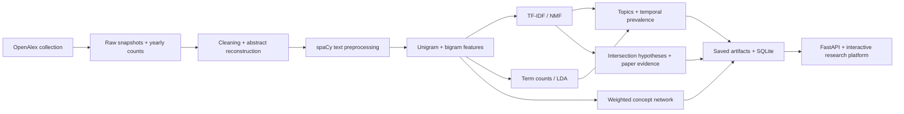

# Research Atlas

A local research intelligence platform for **scientific literature mining and research-gap discovery**. Explore 10,000 real AI research papers, compare learned topics, follow their evolution, inspect concept relationships, and investigate evidence-backed research hypotheses.

Built with **Next.js · TypeScript · Tailwind CSS · FastAPI · scikit-learn · spaCy · NetworkX · Plotly · Cytoscape · SQLite**. Runs on Windows without paid services, external LLMs, or Google Colab. Models and data are bundled; browsing does not trigger training or API downloads.

**10,000 papers · 8 years · 10 topics per model · 36 review hypotheses**

[Getting started](#launch-on-this-machine) · [Platform](#explore-the-platform) · [Evaluation](#actual-evaluation) · [Methodology](#dataset-and-analysis-methodology) · [Tests](#tests-and-development) · [Walkthrough](docs/DEMONSTRATION.md)

## From literature to research questions

The pipeline keeps each inference connected to the original literature:



| Analysis capability | Implementation | Inspectable output |
|---|---|---|
| Text preprocessing & feature extraction | Reconstructed abstracts, explicit missingness, spaCy tokenization, stopword removal, unigram/bigram counts and sublinear TF-IDF | Source papers, coverage flags, persisted vectorizers and sparse feature matrices |
| Topic modelling | Independently fitted LDA and NMF; labels assembled from learned component terms | Topic words, representative papers, document assignments and model comparison |
| Temporal analysis | Annual normalized topic prevalence, sample intervals and abstract-only sensitivity | Interactive composition charts plus separate unsampled publication-volume counts |
| Technical-term extraction | Terms ranked by corpus TF-IDF mass | Scientific-term candidates with real document frequencies and source evidence |
| Concept relationships | NetworkX document co-occurrence and Jaccard-weighted edges | Zoomable, draggable graph with concept-linked literature |
| Research-gap exploration | Transparent intersection-deficit, balanced-support and learned-affinity ranking | Review hypotheses, threshold sensitivity, marginal literature and existing intersection counter-evidence |

Evaluation measures coherence, diversity and initialization stability; interpretability is assessed by reading learned terms and representative papers. The platform assists literature review rather than claiming automatic proof of novelty.

## Explore the platform

### Literature explorer

Search titles, abstracts and keywords. Filter by publication year, learned topic, model and text coverage; sort by relevance, citations or recency. Original OpenAlex and DOI references remain attached to every record.

<details>
<summary>Paper details and explicit missing-abstract handling</summary>

The centered, keyboard-accessible paper dialog shows original metadata and source links. Title-only records explain why no abstract is displayed; missing text is never invented.

</details>

### Topic discovery

Switch between models, inspect their learned vocabulary, and read the papers behind a topic. Labels are generated from model outputs rather than manually authored results.

### Research trends

Explore topic prevalence by model, theme and year range. The abstract-only view makes text-coverage sensitivity visible; corpus-volume charts remain distinct from equal-year sample prevalence.

### Concept network

Drag and zoom the relationship graph, change the shared-paper threshold, and select a term to inspect frequencies, connected concepts and actual supporting literature.

### Research-gap explorer

Ranked candidates expose the observed intersection, independence baseline, term affinity and score formula. Existing intersection papers are shown as counter-evidence alongside separate-theme literature. Every candidate remains a **review hypothesis**.

### Model evaluation

Inspect real held-out metrics, compare the models, expand methodology notes and export the evaluation JSON. Model-specific errors are separated to avoid misleading comparisons.

## Launch on this machine

The dataset, saved models, database and production build are already present on the development machine.

```powershell
.\start.bat
```

Open **http://127.0.0.1:3000**. API documentation: **http://127.0.0.1:8000/docs**.

```powershell
.\stop.bat
```

The launcher starts hidden background services, checks readiness, saves process IDs, and writes logs to `.runtime/`. Ports 3000 and 8000 must be free. If already running, use the existing app or stop it first. The stop script leaves data and artifacts intact.

## Install on another Windows machine

Install **Python 3.12** with the Windows launcher and **Node.js 24 LTS**. Clone the repository, then install dependencies and launch:

```powershell
git clone https://github.com/xMN-28/research-atlas.git
cd research-atlas
powershell -NoProfile -ExecutionPolicy Bypass -File scripts\setup.ps1
.\start.bat
```

Python dependencies are pinned in `requirements.txt`; frontend dependencies use `package-lock.json` and `npm ci`. No virtual-environment activation or permanent execution-policy change is needed. The launcher trains once if artifacts are missing and builds once if the frontend build is missing. The API does not use the OpenAlex credential; `.env` is only used for collection and is never sent to the browser.

The repository includes the original CSV, yearly provenance, raw snapshots, trained models and SQLite database for reproducibility and offline use. Dependencies, build output, runtime logs and `.env` are excluded from Git. A fresh clone builds the frontend on its first launch and uses the bundled models without retraining. GitHub access is required to clone a private repository.

## Seven functional pages

| Page | Function |
|---|---|
| Overview | Actual corpus counts, coverage, topics, ranked hypothesis and saved-model status |
| Literature explorer | Full-text title/abstract/keyword search, year/topic/model/coverage filters, sorting, pagination, abstracts and OpenAlex/DOI links |
| Topic discovery | LDA/NMF switch, learned words, generated labels, dominant assignments and representative papers |
| Research trends | Model/topic/date filters, mean topic weights, sampling intervals, abstract-only sensitivity and separate corpus volume |
| Concept network | Zoomable/draggable graph, true document frequencies and Jaccard edges, edge threshold and concept-linked papers |
| Research gaps | Ranked review hypotheses, margins, scoring, threshold sensitivity, supporting and contradictory papers |
| Model evaluation | Real metrics, comparison plots, methods, provenance and JSON export |

Responsive navigation, persistent light/dark mode, keyboard-accessible native paper dialogs, reduced-motion support, chart tooltips/legend toggles/zoom/export, loading indicators, empty states and recoverable errors are included. API requests read saved outputs and **never retrain** models.

## Retrain or rebuild

Stop services before replacing artifacts; restart to reload the backend cache.

```powershell
.\stop.bat
.venv\Scripts\python train.py
.\start.bat -Rebuild
```

Defaults: 10 topics/model, up to 6,000 unigram/bigram features, `min_df=12`, `max_df=0.65`, seed 42. NMF uses sublinear TF-IDF; LDA uses raw counts. Evaluation models fit an 80% year-stratified split and coherence is evaluated on the other 20%. A second seed checks initialization stability. Separate production models then fit all eligible records. Training takes about a minute here; timing varies by hardware.

```powershell
.venv\Scripts\python train.py --topics 12 --max-features 8000
```

For different-sized **2018–2025** collections, regenerate CSV and matching provenance with Phase 1's `--per-year`/`--candidates` flags, then use `train.py --allow-new-corpus`. The default trainer protects the existing 10,000 records. Duplicate IDs, mismatched sampling counts and checksum changes fail explicitly. Extending the year range requires updating collection configuration and frontend year controls; this release demonstrates 2018–2025.

## Actual evaluation

From `artifacts/evaluation.json`: **7,818 training documents**, **1,955 held-out documents**.

| Metric | NMF | LDA |
|---|---:|---:|
| Held-out document NPMI coherence | 0.3311 | 0.1363 |
| Top-10 term diversity | 0.9600 | 0.8300 |
| Matched cosine seed stability | 1.0000 | 0.7539 |
| Lexical distinctiveness proxy | 0.8400 | 0.9400 |
| Held-out TF-IDF reconstruction RMSE | 0.012555 | — |
| Held-out count perplexity | — | 3035.56 |

NMF has higher coherence/diversity in this run. Its near-unit seed stability reflects NNDSVD-based initialization on fixed data and does not establish general robustness. LDA uses 12 iterations; longer training and parameter selection remain future experiments. Perplexity and reconstruction RMSE measure different objectives and are **not directly comparable**. Interpretability is assessed by inspecting terms and papers; lexical distinctiveness is not a human interpretability rating. The vocabulary is corpus-wide, so held-out results are descriptive topic assessment rather than a leakage-free prediction benchmark. There are no ground-truth topic/gap labels.

## Dataset and analysis methodology

All **10,000** records remain in CSV/SQLite, including **2,421 missing abstracts**. Features use titles plus available abstracts, with explicit `title-only`/`title-and-abstract` flags and no silent imputation. **9,773** records have retained vocabulary features; **227** do not and remain searchable with topic `-1`, excluded from topic means and gaps.

spaCy tokenizes locally without a downloaded language model. Preprocessing lowercases alphabetic tokens and removes English plus Spanish/Indonesian/Portuguese/French/German stopwords and corpus boilerplate. No translation or lemmatization occurs. Language-specific and generic-method topics can still appear; they are not manually relabeled as scientific findings. Technical terms are statistical candidates, not ontology-validated entities.

Every original year has 1,250 sampled records. Mean normalized topic weights measure sample composition; equal-year sample counts do not measure publication growth. Separate unsampled OpenAlex corpus counts are preserved in `data/metadata/sampling.json`. Topic charts offer abstract-only sensitivity and approximate 95% intervals for sample variability, excluding model/classification uncertainty. Ineligible records are excluded from topic-weight denominators, with original annual counts retained separately.

Network nodes are the top 65 features by total TF-IDF mass. Edges count documents containing both terms, with Jaccard similarity as normalized weight. Minimum co-occurrence is 20 papers; strongest 200 Jaccard edges are displayed. A phrase and a component word can mechanically co-occur. Association does not establish causality.

Gap candidates use normalized NMF membership ≥0.15 in abstract-bearing eligible records, margins ≥100, and observed intersections below `margin_a × margin_b / eligible_population`.

```text
score = deficit fraction × margin balance
      × log(1 + smaller margin) / log(1 + eligible population)
      × sqrt(cosine similarity of learned topic-term vectors)
```

Learned affinity reduces the priority of unrelated themes. Separate-theme papers establish substantive marginal literature; actual intersection papers are shown as counter-evidence to novelty. Threshold 0.10/0.15/0.20 and title-only inclusion sensitivity are saved. The run yields **36 review hypotheses**, not validated research gaps. Normalized mixtures impose compositional dependence; the independence baseline is a heuristic, not a significance test. Language, missingness, natural specialization and model boundaries can explain deficits. Read the evidence and search beyond this corpus before claiming novelty.

Selection is OpenAlex **primary-topic AI subfield 1702**, years 2018–2025, `article|preprint`. Secondary AI topics may be missed; classifications/coverage evolve. Citations are cumulative at acquisition and favor older papers. Seeded live API queries cannot freeze an evolving database; raw snapshots provide exact reproducibility. The original collector is preserved in [PHASE1.md](PHASE1.md); Phases 2–3 did not redownload papers. Attribution: [OpenAlex](https://openalex.org/) metadata under CC0; abstracts are source metadata rather than full-text PDFs. Fontshare/Indian Type Foundry typography attribution is in `frontend/public/fonts/ATTRIBUTION.md`.

## Structure

```text
collect.py / train.py           offline collection and modelling entry points
src/literature_mining/          collection, cleaning, models, evaluation, evidence
backend/main.py                read-only FastAPI with SQLite FTS
frontend/app/                  Next.js pages, layout, Tailwind stylesheet
frontend/components/           charts, network, paper dialog, page components
frontend/tests/                Playwright browser suite
tests/                         Python collection/analysis/API tests
scripts/                       Windows setup/start/stop
docs/DEMONSTRATION.md           six-task presentation walkthrough
data/                          original CSV, raw snapshots and provenance
artifacts/models.joblib        fitted vectorizers, NMF and LDA
artifacts/features.joblib      sparse features, topic weights and split indices
artifacts/research.sqlite      every paper, assignments and full-text index
artifacts/analysis.json         topics, trends, network and review hypotheses
artifacts/evaluation.json       real metrics, methods and dataset checksum
verification/                  browser results and reviewed screenshots
.env / .env.example             ignored credential and safe template
```

Only load joblib artifacts generated by this trusted local pipeline; they use Python pickle serialization. The API reads JSON/SQLite without loading arbitrary model files.

## Tests and development

With services running:

```powershell
.venv\Scripts\python -m pytest -q
cd frontend
npm.cmd run typecheck
npm.cmd run build
npx.cmd playwright install chromium
npm.cmd run test:e2e
```

**17 Python tests and 5 browser tests passed**, with production build/TypeScript checks passing. Tests verify every hypothesis's observed intersections against saved model weights and resolve all evidence IDs to real records. Browser suites exercise all pages, charts, graph canvas, search/filter/sort/modal/pagination, empty states, model switching, trend sensitivity, evidence panels, exports, themes, mobile navigation and simulated 503/retry recovery. See `verification/VERIFICATION.md`. A harmless Starlette/HTTPX test-client deprecation warning is recorded.

For development, use two terminals:

```powershell
.venv\Scripts\python -m uvicorn backend.main:app --host 127.0.0.1 --port 8000 --reload
```

```powershell
cd frontend
npm.cmd run dev
```

The frontend proxies `/api/*` to loopback port 8000; both production services bind locally. After initial installation, the application works offline using saved data/models; only opening external paper references needs an internet connection.
